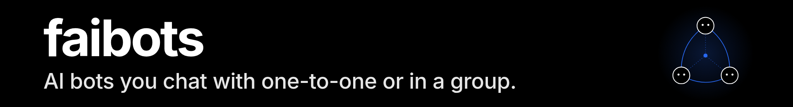

<p align="center">
  <picture>
    <source media="(prefers-color-scheme: dark)" srcset="docs/media/faibots-hero-dark.png">
    <source media="(prefers-color-scheme: light)" srcset="docs/media/faibots-hero-light.png">
    
  </picture>
</p>

<p align="center">
  <a href="https://github.com/fai-qa/faibots/actions/workflows/windows-checks.yml"></a>
  <a href="LICENSE"></a>
  <a href="https://github.com/fai-qa/faibots/releases"></a>
  
</p>

# faibots

A Windows desktop app where you create role-based bots that chat with you and with each other, using your own model provider.

Windows only for now.

Prompts and the context sent with them go to the model provider you pick, and to any MCP tools you connect. If you pick a local OpenAI-compatible server such as Ollama, that model runs on your machine or network.

The app runs on your computer. Your bots can talk to each other, and there's no hosted account to sign up for.

Chat one-to-one or in a group. Run routines. Bring your own model providers and MCP connectors. Chats, bots and settings are stored on your computer.

<!-- demo GIF: two-bot group chat, added in a later PR -->

## Quick start

Use Windows x64, Git and Node.js 24.20.0.

```powershell
git clone https://github.com/fai-qa/faibots.git
cd faibots
npm ci
npm run dev
```

## What you can do

Give each bot a role and a model. Talk to one directly, or bring several into a group chat, where they can ask each other for help. You choose which tools and connectors each bot can use, and which actions need your approval.

## Run from source

Model availability and sign-in depend on your provider. Install and start from the source directory with the Quick start commands.

## Start with fai

1. The app opens in your chat with **fai**, the main bot. In **Settings**, open **Models & providers**, choose **Add provider**, connect a provider you already use, and press **Test**. Choose its model on **Profile** for fai.
2. Give fai a job. For example, “Find a bot to edit this product description. If we need an editor, propose one. Bring the revised text back here.”
3. When a new bot is needed, review its role and model in the approval card. A specialist can use the configured default model or the model already assigned to fai.
4. You can also create bots yourself in **New Bot**, give one a name and a **Label**, and select its model on **Profile**. Open its chat to talk directly to a specialist, or use **New chat** and select both for a group. You can choose several bots in that chat. Reopening the app takes you back to fai.

You can speak to fai in English, Arabic or a mix. Ask for what you want back. A request with a clear answer can finish in one sentence. When a job needs several steps, fai can keep a work brief in the chat. Open it to see the deliverable and checks, update that job, answer a question, or accept a result. **Scope and limits** shows the selected inputs, how many specialists fai can assign and where fai will return the result. A specialist can work in the background while you speak with fai. The brief and the results fai has checked stay there when you reopen the app.

When bots work together, select the message count in your chat to read what they said for that job. Choose **Close chat** or press **Esc** to return to the same place.

Each project has a Library for the source versions you choose, a Space for reviewed Pages, and its own session history. You choose which work to bring into a new session. To discuss a search result in your main chat, choose **Ask fai** below the result, enter your instruction, and select **Send to fai**. To ask a follow-up about the same evidence, use **Reply** on the answer in chat. Project instructions can be tried on two sets of notes before you activate them.

A bot’s profile gives you access to its tools, memory, skills and routines. Start a routine manually to check its result before giving it a schedule. Scheduled routines run while the desktop app is open.

Tools and connectors can access additional information according to their permissions.

## Checks

```powershell
npm run typecheck
npm test
npm run build
```

The desktop app uses Electron. The optional browser UI preview uses example data. Routines require the desktop process to be running. This release is a source preview. Build configuration is included for maintainers preparing a Windows installer.

On Windows, `npm run prestart` followed by `node tests/windows-desktop-smoke.cjs` checks the built desktop app with a local model fixture. It exercises the desktop runtime with fictional data and checks that records survive reopening.

Maintainers can assemble a portable ZIP from the same checkout with Python 3.12 or later. After building the app, run these commands from the repository root on Windows. Choose a new ZIP filename for each build.

```powershell
npm run prestart
npx --no-install electron-builder --win --x64 --dir --publish never
python -B scripts/package-windows-preview.py dist/win-unpacked dist/faibots-windows-x64.zip
```

## Troubleshooting

If Electron exits immediately on Windows, run `npm run prestart` to download the locked runtime. Check that `node_modules/electron/dist` exists, then run `npm run dev` again. Keep sandboxing enabled. [Electron's Windows launch issue](https://github.com/electron/electron/issues/54614)

## Licensing

The fai.qa-owned code and documentation are available under the [MIT License](LICENSE). The brand assets and integrated affectUI Pro component keep their separate terms. See [Notice](NOTICE.md) and [third-party notices](THIRD_PARTY_LICENSES/README.md).

See [Contributing](CONTRIBUTING.md) for feedback and changes, and [Security](SECURITY.md) for private vulnerability reports.
